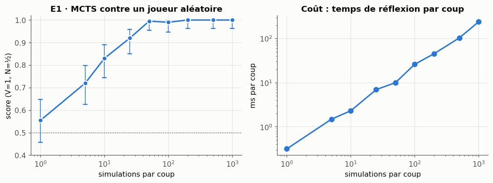
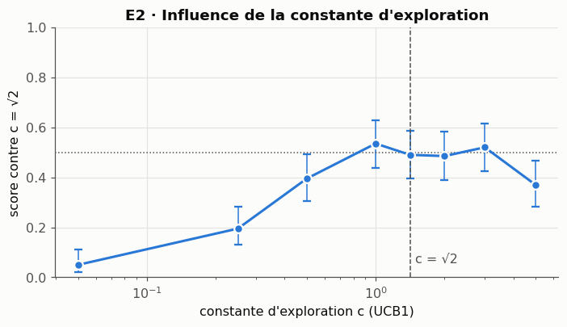
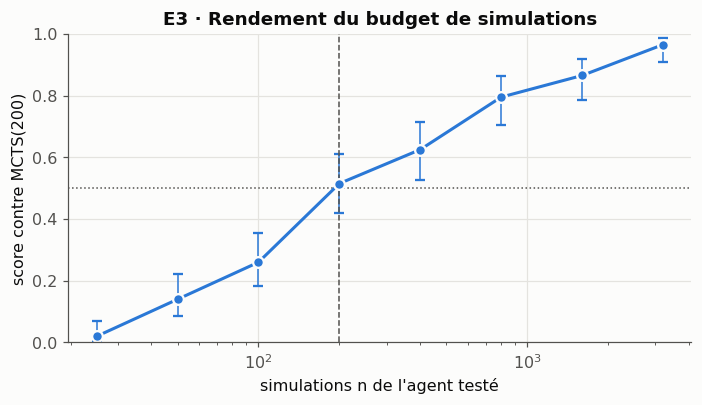
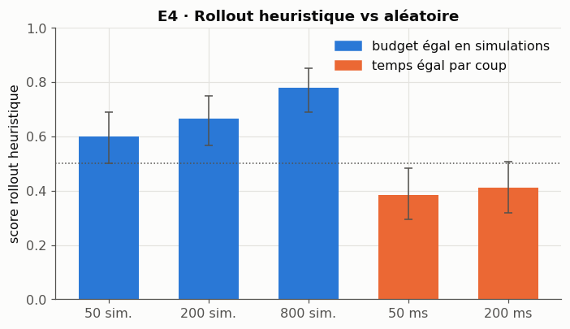
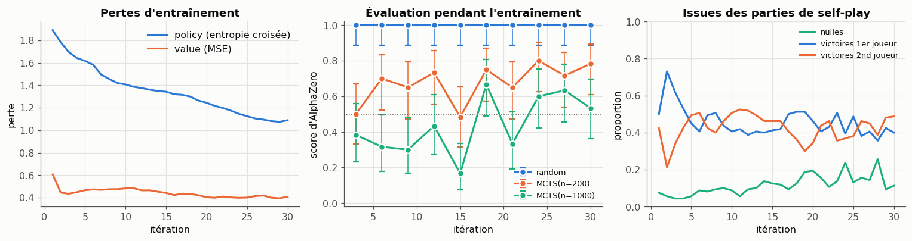
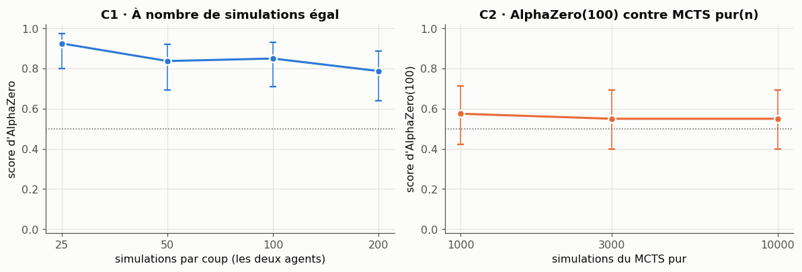
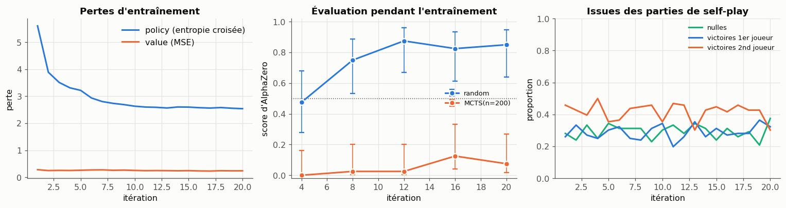

# Rapport — MCTS et Self-Play pour jeux à deux joueurs

## 1. Objectif et démarche

Nous construisons un agent pour des jeux à deux joueurs, à somme nulle et à information complète,
en trois étapes :

1. **MCTS pur (UCT)** sur Puissance 4, avec des rollouts aléatoires ou heuristiques. Nous étudions
   l'effet du nombre de simulations, de la constante d'exploration UCB1 et de la politique de rollout.
2. **Self-play + réseau policy/value (AlphaZero simplifié)**. Le réseau remplace les rollouts et guide
   la recherche (PUCT). Il est entraîné sur les parties que l'agent joue contre lui-même.
3. **Comparaison avec et sans réseau** sur la variante allégée des échecs (Niveau 2). Nous faisons aussi
   la comparaison sur Puissance 4, où le budget CPU permet d'obtenir un signal net.

Tout le code partage une interface `GameState` (`mcts_rl/games/base.py`). Les mêmes agents (MCTS pur,
AlphaZero) tournent donc sans modification sur les deux jeux.

### Moteurs de jeu

* **Puissance 4** : moteur bitboard minimal, en reprenant la représentation standard (7 bits par
  colonne, détection d'alignement par décalages). Le projet ne porte pas sur le moteur. Nous
  choisissons cette représentation pour la vitesse : le MCTS pur simule des millions de coups.
  Un test le compare à un vérificateur naïf sur 300 parties aléatoires.
* **Échecs** : les règles viennent de **python-chess**. Nous ajoutons seulement l'interface agent :
  * action = `case_départ × 64 + case_arrivée` (4096 actions). Les promotions se font en dame
    uniquement, les sous-promotions sont retirées ;
  * état = 17 plans 8×8 : 6 types de pièces « à moi », 6 types « adverses », 4 droits de roque,
    progression de la partie. L'état est toujours vu du point de vue du joueur au trait : le plateau
    est retourné pour les Noirs, comme dans AlphaZero ;
  * **variante « mini »** (`rn2k1nr/pppppppp/8/8/8/8/PPPPPPPP/RN2K1NR`) : ni dame ni fous, et une
    limite de 80 demi-coups. À la limite, la partie est adjugée au joueur qui a au moins 2 points
    d'avantage matériel, sinon elle est nulle. Le sujet autorise cette variante allégée faute de
    temps. Elle rend l'entraînement possible sur CPU. Les variantes `standard` et `micro` restent
    jouables.

## 2. MCTS pur (UCT) — `mcts_rl/agents/mcts.py`

Chaque simulation enchaîne quatre phases :

| Phase | Implémentation |
|---|---|
| Sélection | descente en maximisant UCB1 : $\bar X_j + c\sqrt{\ln N / n_j}$ |
| Expansion | ajout d'**un** enfant pris au hasard parmi les coups non essayés |
| Simulation | rollout jusqu'à la fin de la partie. La politique est aléatoire, ou heuristique (gagner si possible, sinon bloquer). Aux échecs, le rollout s'arrête après 20 demi-coups et la position est évaluée au matériel ($\tanh(\Delta/5)$) |
| Rétropropagation | chaque nœud cumule le résultat **du point de vue du joueur qui a joué le coup y menant** |

Le coup joué est l'enfant le plus visité (*robust child*). Le budget est un nombre de simulations ou
un temps par coup.

### 2.1 Résultats — Niveau 1 (Puissance 4)

Protocole commun : 100 parties par configuration, avec alternance des couleurs (chaque agent commence
50 fois). Le score compte 1 pour une victoire et ½ pour une nulle. Les intervalles sont des IC à 95 %
de Wilson. Le temps par coup a été mesuré sur un portable 4 cœurs pendant qu'un autre calcul tournait :
seuls les rapports entre ces temps sont significatifs. Les données brutes sont dans `results/level1/*.json`.

#### E1 — MCTS contre un joueur aléatoire



| simulations / coup | 1 | 5 | 10 | 25 | 50 | 100 | 200 | 500 | 1000 |
|---|---|---|---|---|---|---|---|---|---|
| score | 0,56 | 0,72 | 0,83 | 0,92 | 0,995 | 0,99 | **1,00** | 1,00 | 1,00 |
| ms / coup | 0,3 | 1,5 | 2,3 | 6,9 | 10 | 26 | 45 | 103 | 239 |

Une seule simulation par coup revient presque à jouer au hasard, avec un léger avantage dû au trait.
Dès **50 simulations**, le MCTS ne perd plus contre l'aléatoire. À partir de 200 simulations, il
gagne 100 % des parties. Le temps de calcul croît linéairement avec le nombre de simulations.
Le joueur aléatoire devient vite un adversaire trop faible pour départager les agents. Les
expériences suivantes opposent donc MCTS à MCTS.

#### E2 — Constante d'exploration c (UCB1)

`MCTS(c, 300 sim.)` contre la référence `MCTS(c = √2, 300 sim.)` :



| c | 0,05 | 0,25 | 0,5 | 1,0 | √2 | 2 | 3 | 5 |
|---|---|---|---|---|---|---|---|---|
| score contre c=√2 | **0,05** | 0,20 | 0,40 | 0,54 | 0,49 | 0,49 | 0,52 | **0,37** |

* **Exploration trop faible** (c ≤ 0,5) : l'algorithme se fige sur le premier coup qui a eu un bon
  rollout et ne réévalue presque jamais les autres. Il rate des menaces et devient très mauvais.
  À c = 0,05, il ne fait plus que 5 % de score.
* **Exploration trop forte** (c = 5) : les visites se répartissent presque uniformément, le budget est
  gaspillé sur des coups manifestement mauvais et les meilleurs coups ne sont pas approfondis
  (score 0,37).
* Entre **c ≈ 1 et 3**, on observe un plateau large où les performances ne se distinguent pas
  statistiquement. La valeur théorique √2 (récompenses dans [0, 1]) est un bon choix par défaut.
  Comme nos récompenses sont dans [-1, 1], l'optimum théorique serait plutôt 2√2 ≈ 2,8, qui se
  trouve aussi dans le plateau.

#### E3 — Rendement du budget de simulations

`MCTS(n)` contre `MCTS(200)` :



| n | 25 | 50 | 100 | 200 | 400 | 800 | 1600 | 3200 |
|---|---|---|---|---|---|---|---|---|
| score contre MCTS(200) | 0,02 | 0,14 | 0,26 | 0,52 | 0,63 | 0,80 | 0,87 | **0,97** |

La force croît de façon régulière avec le **logarithme** du budget. Chaque doublement apporte un gain
net, mais le coût en temps double à chaque fois. Ce rendement décroissant explique l'intérêt du
Niveau 2 : on peut chercher à rendre chaque simulation plus informative au lieu d'en faire plus.

#### E4 — Politique de rollout : heuristique contre aléatoire

Le rollout heuristique joue le coup gagnant s'il existe, sinon il bloque le coup gagnant adverse,
sinon il joue au hasard.



| comparaison | score du rollout heuristique |
|---|---|
| budget égal, 50 simulations | 0,60 |
| budget égal, 200 simulations | 0,67 |
| budget égal, 800 simulations | **0,78** |
| temps égal, 50 ms / coup | 0,39 |
| temps égal, 200 ms / coup | 0,41 |

Ce résultat est instructif. **À nombre de simulations égal**, les rollouts heuristiques sont nettement
meilleurs : une partie simulée avec des coups « raisonnables » estime mieux la valeur d'une position
qu'une partie jouée au hasard, où chaque camp rate des gains immédiats. **À temps égal**, en revanche,
l'heuristique **perd**. Elle coûte environ 4 à 5 fois plus cher par coup simulé (elle teste les 7
colonnes pour chaque joueur), et le MCTS aléatoire compense largement par le nombre de simulations.
La qualité d'un rollout se paie donc en quantité. C'est exactement le compromis qu'AlphaZero tranche
en remplaçant le rollout par une évaluation apprise.

#### E5 — Avantage du premier joueur

Pour deux MCTS identiques, le score du joueur qui commence vaut 0,54 (n = 50), 0,51 (n = 200) et
0,555 (n = 1000). L'avantage théorique du premier joueur (Puissance 4 est résolu : le premier joueur
gagne en jouant au centre) n'apparaît que faiblement à ces niveaux de jeu. L'alternance des couleurs
dans tous nos matchs supprime ce biais.

#### Jouer contre l'agent

`python scripts/play.py --p1 human --p2 mcts:2000` (ou `mcts-h:` pour les rollouts heuristiques).
Les tests unitaires vérifient que l'agent joue un gain immédiat et bloque une menace immédiate
(`tests/test_agents.py`). Nous n'avons pas fait de série de parties contre des humains : nous ne
donnons donc pas de taux de victoire contre un humain. Une limite structurelle est attendue : des
rollouts aléatoires évaluent mal les menaces lointaines (zugzwang sur les rangées paires et impaires),
qu'un joueur expérimenté peut exploiter.

## 3. Self-play et réseau policy/value (AlphaZero simplifié)

### 3.1 Pourquoi un réseau

Le Niveau 1 montre les deux limites du MCTS pur :

* la force progresse avec le **logarithme** du nombre de simulations (E3) ;
* améliorer la qualité des rollouts coûte plus cher que ce que cela rapporte (E4).

AlphaZero remplace le rollout par un réseau $f_\theta(s) = (\mathbf p, v)$. La sortie $v$ estime
directement l'issue de la partie et $\mathbf p$ donne un *prior* sur les coups. Le réseau ne peut
progresser que s'il est entraîné, et c'est le rôle du self-play : l'agent joue contre lui-même,
la recherche MCTS produit des cibles de meilleure qualité que le réseau seul, et le réseau apprend
à les imiter. Comme le rappelle le sujet, du self-play avec de simples rollouts aléatoires
n'améliorerait rien, puisqu'aucun paramètre n'est appris.

### 3.2 MCTS guidé (PUCT) — `mcts_rl/agents/alphazero.py`

| Phase | MCTS pur (Niveau 1) | MCTS guidé (Niveau 2) |
|---|---|---|
| Sélection | UCB1 $Q + c\sqrt{\ln N / n}$ | PUCT $Q + c_{puct}\, P(s,a)\,\sqrt{N(s)}/(1+N(s,a))$ |
| Expansion | un enfant à la fois | tous les enfants, avec leur prior $P(s,a)$ |
| Évaluation | rollout jusqu'à la fin de la partie | valeur $v$ du réseau, sans rollout |
| Rétropropagation | résultat du rollout | $v$, avec un changement de signe à chaque niveau |
| Exploration en self-play | — | bruit de Dirichlet à la racine ($\varepsilon=0{,}25$), coup tiré ∝ visites pendant les premiers coups ($\tau=1$), puis coup le plus visité |

### 3.3 Réseau — `mcts_rl/nn/model.py`

ResNet réduit : une convolution d'entrée, puis 3 blocs résiduels de 48 canaux (BatchNorm + ReLU).
Deux têtes en sortie :

* **policy** :
  * Puissance 4 : couche dense vers 7 logits ;
  * échecs : tête entièrement convolutive. Une convolution 1×1 produit 64 plans. La valeur du plan
    *t* en position *f* est le logit du coup *f → t*. Les 4096 logits restent ainsi liés à la
    géométrie du plateau, pour très peu de paramètres ;
* **value** : couche dense suivie de $\tanh$, à valeur dans [-1, 1].

Les coups illégaux sont masqués avant le softmax. La perte est
$\mathcal L = (z - v)^2 - \boldsymbol\pi^\top \log \mathbf p + \lambda\|\theta\|^2$,
avec $\lambda$ appliqué par le *weight decay* d'Adam.

### 3.4 Boucle d'entraînement — `mcts_rl/selfplay.py`

```
réseau θ0 aléatoire
pour chaque itération k :
    self-play : N parties jouées par MCTS(θk) contre lui-même -> exemples (s, π_MCTS, z)
                (Puissance 4 : on double les exemples par symétrie gauche/droite)
    buffer    : exemples des 5 à 6 dernières itérations
    apprentissage : environ 4 passages sur chaque nouvel exemple (Adam, lr 1e-3, batch 256)
    évaluation : matchs contre l'aléatoire et contre le MCTS pur (toutes les 3 ou 4 itérations)
```

Comme AlphaZero et contrairement à AlphaGo Zero, nous n'utilisons pas de *gating* : le réseau
courant est toujours celui qui génère les parties.

**Optimisation pour CPU.** Évaluer une position à la fois coûte environ 3 ms par simulation, presque
uniquement en surcoût de PyTorch. Le self-play fait donc avancer 24 à 40 parties en même temps dans
chaque processus. À chaque simulation, il sélectionne une feuille par arbre et évalue toutes ces
feuilles en un seul passage du réseau. Quatre processus tournent en parallèle. Le profilage montre
qu'ensuite environ 60 % du temps reste dans les convolutions : nous avons donc réduit le réseau de
64×4 à 48×3, ce qui a divisé le coût par deux.

| préréglage | itérations | parties / itér. | simulations / coup | taille du réseau |
|---|---|---|---|---|
| `connect4` | 30 | 160 | 100 | 48 canaux × 3 blocs (130 k paramètres) |
| `chess-mini` | 20 | 96 | 64 | 48 canaux × 3 blocs, tête 4096 (142 k paramètres) |

## 4. Résultats — Niveau 2

### 4.1 Puissance 4 : avec et sans réseau

Nous avons fait 30 itérations de self-play, soit 4 800 parties et environ 270 000 exemples après
symétrie. L'entraînement a duré 82 min sur le CPU du portable (4 cœurs, sans GPU).



* La perte de la policy baisse régulièrement, de 1,89 à 1,09 : le réseau imite de mieux en mieux les
  distributions de visites du MCTS. La perte de la value se stabilise vers 0,40. Elle ne peut pas
  tendre vers 0, car l'issue d'une partie de self-play reste en partie aléatoire (exploration).
* Pendant l'entraînement, AlphaZero (100 simulations) joue des évaluations sur 30 parties, ce qui
  donne des mesures bruitées. Il bat l'aléatoire 30/30 dès l'itération 3. Contre le MCTS pur à 200
  simulations, son score monte de 0,50 à environ 0,78. Contre le MCTS pur à **1000 simulations**,
  il passe de 0,38 à 0,53–0,63.
* Les parties de self-play deviennent plus longues (24 → 30 coups) et plus souvent nulles
  (5 % → 10 à 25 %). Les deux camps se défendent mieux.

Comparaisons finales sur 40 parties par match, avec alternance des couleurs (`results/level2/connect4/comparisons.json`) :



| | match | score d'AlphaZero [IC95] |
|---|---|---|
| **C1** — simulations égales | AZ(25) vs MCTS pur(25) | **0,93** [0,80–0,97] |
| | AZ(50) vs MCTS pur(50) | 0,84 [0,69–0,92] |
| | AZ(100) vs MCTS pur(100) | 0,85 [0,71–0,93] |
| | AZ(200) vs MCTS pur(200) | 0,79 [0,64–0,89] |
| **C2** — MCTS pur plus coûteux | AZ(100) vs MCTS pur(1000) | 0,575 [0,42–0,71] |
| | AZ(100) vs MCTS pur(3000) | 0,55 [0,40–0,69] |
| | AZ(100) vs MCTS pur(10 000) | 0,55 [0,40–0,69] |
| **C3** — ablations | réseau **non entraîné** + MCTS(100) vs MCTS pur(100) | 0,66 [0,51–0,79] |
| | réseau **entraîné** + MCTS(100) vs MCTS pur(100) | **0,90** [0,77–0,96] |
| | réseau seul, **sans recherche**, vs aléatoire | 1,00 (40/40) |
| | réseau seul, sans recherche, vs MCTS pur(100) | 0,50 |
| | AZ final vs AZ itération 15 (100 sim. chacun) | **1,00** (40/40) |
| | AZ final vs AZ itération 0 (100 sim. chacun) | 1,00 (40/40) |

**Analyse :**

* **À simulations égales, le réseau domine nettement** (C1 : 0,79 à 0,93). Chaque simulation guidée
  vaut bien plus qu'une simulation avec rollout aléatoire. L'écart se réduit quand le budget
  augmente, car le MCTS pur rattrape une partie de son retard par la force brute.
* **AlphaZero avec 100 simulations tient tête à un MCTS pur avec 10 000 simulations**, soit 100 fois
  plus de simulations (C2 : score de 0,55). Mesuré dans les mêmes conditions, un coup d'AZ(100) prend
  environ 130 ms, contre environ 2,4 s pour MCTS(10 000) (extrapolation linéaire de E1, où
  1000 sim. ≈ 240 ms). **À force égale, l'agent avec réseau réfléchit donc environ 15 à 20 fois
  moins longtemps.** Le score reste près de 0,55 entre 1000 et 10 000 simulations : le MCTS pur
  plafonne, car ses rollouts aléatoires évaluent mal les menaces lointaines, même avec beaucoup de
  simulations.
* **Le self-play est bien ce qui fait progresser l'agent.** Avec le même algorithme de recherche, le
  réseau final bat 40/40 le réseau de l'itération 15 et celui de l'itération 0. À l'inverse,
  l'agent qui garde son réseau non entraîné n'atteint que 0,66 contre le MCTS pur, contre 0,90 une
  fois entraîné. Ce 0,66 s'explique ainsi : un réseau non entraîné renvoie une valeur quasi
  constante et des priors quasi uniformes. La recherche PUCT devient alors une exploration en
  largeur qui ne réagit qu'aux fins de partie exactes. Elle trouve donc les gains et parades à
  courte portée, là où les rollouts aléatoires bruitent l'estimation.
* **La policy a « distillé » la recherche.** Sans aucune simulation, en 2 ms par coup, le réseau seul
  fait jeu égal (0,50) avec un MCTS pur à 100 simulations, qui prend environ 25 ms par coup. Le
  self-play a transféré dans les poids une partie de ce que calculait la recherche.

*Remarque sur les temps : pendant le match AZ(100) vs MCTS(3000), la machine s'est mise en veille.
La durée enregistrée pour ce match, 9180 s, n'a donc pas de sens ; son score reste valide.*

### 4.2 Échecs (variante « mini ») : avec et sans réseau

Nous avons fait 20 itérations de self-play, soit 1 920 parties et 151 000 positions. Hors mise en
veille de la machine et partage du CPU, une itération prend environ 2 min 30 : l'entraînement
complet représente donc environ 1 h de calcul.



Le MCTS pur utilisé comme référence « sans réseau » a deux réglages possibles :

* **avec heuristique** : rollout aléatoire tronqué à 20 demi-coups, puis évaluation au matériel
  $\tanh(\Delta/5)$. C'est la référence par défaut ;
* **sans heuristique** : rollout aléatoire joué jusqu'à la fin de la partie.

Matchs de 20 parties (`results/level2/chess-mini/comparisons.json`) :

| | match | score d'AlphaZero [IC95] |
|---|---|---|
| **C1** — simulations égales | AZ(16) vs MCTS pur(16) | 0,50 [0,30–0,70] |
| | AZ(32) vs MCTS pur(32) | 0,375 [0,20–0,59] |
| | AZ(64) vs MCTS pur(64) | 0,275 [0,13–0,49] |
| | AZ(128) vs MCTS pur(128) | 0,35 [0,18–0,57] |
| **C2** — budget de référence | AZ(100) vs MCTS pur(10) | 0,70 [0,48–0,85] |
| | AZ(100) vs MCTS pur(25) | 0,675 [0,46–0,84] |
| | AZ(100) vs MCTS pur(50) | 0,425 [0,24–0,64] |
| **C3** — ablations | réseau **non entraîné** + MCTS(100) vs MCTS pur(100) | 0,025 |
| | réseau **entraîné** + MCTS(100) vs MCTS pur(100) | 0,275 |
| | réseau seul (sans recherche) vs aléatoire | 0,70 |
| | réseau seul (sans recherche) vs MCTS pur(100) | 0,025 |
| | AZ(100) vs MCTS pur(200) **sans heuristique** | 0,15 |
| | *(contrôle)* MCTS pur(200) avec heuristique vs sans heuristique | 0,725 |
| | AZ final vs AZ itération 10 | **0,75** (10 V, 10 N, 0 D) |
| | AZ final vs AZ itération 0 | **1,00** (20/20) |

**Analyse :**

* **Le self-play améliore nettement l'agent.** Le réseau final bat 20 fois sur 20 le réseau de
  départ et ne perd aucune partie contre celui de l'itération 10. Son score contre l'aléatoire passe
  de 0,475 (itération 4) à 0,85 (itération 20). La perte de la policy baisse de 5,6 à 2,5 : le réseau
  a appris où vont les visites du MCTS parmi environ 25 coups légaux, ce qui correspondrait à une
  perte de ln 25 ≈ 3,2 pour une policy uniforme. Une sonde sur des positions déséquilibrées montre
  aussi que la tête value a appris qu'**une tour de plus est un avantage**, et cela de façon
  cohérente pour les Blancs et pour les Noirs grâce à l'encodage relatif au joueur au trait.
* **Avec ce budget de calcul, le réseau ne dépasse pas encore le MCTS pur.** À simulations égales,
  AlphaZero obtient 0,27 à 0,50. AlphaZero(100) vaut à peu près un MCTS pur de 25 à 50 simulations.
  C'est l'inverse de Puissance 4, et l'écart d'échelle l'explique :

  | | Puissance 4 | échecs mini |
  |---|---|---|
  | coups légaux par position | ≤ 7 | ≈ 25 (4096 sorties de policy) |
  | longueur d'une partie | ≈ 30 coups | 80 demi-coups (limite atteinte) |
  | parties de self-play | 4 800 | 1 920 |
  | positions / taille de l'espace des actions | ≈ 38 000 | ≈ 37 |

  Le signal de valeur aux échecs est aussi beaucoup plus bruité. Presque toutes les parties de
  self-play atteignent la limite de 80 demi-coups, et l'issue se décide alors sur un écart de
  matériel accumulé par des coups encore très imprécis. Le réseau doit attribuer ce résultat aux
  40 coups de chaque camp. Pour comparaison, AlphaZero a utilisé 44 millions de parties pour les
  échecs, avec des milliers de TPU.
* **Le MCTS pur est un adversaire fort dans cette variante**, parce que sa simulation contient déjà
  la règle qui décide les parties. L'adjudication se fait au matériel, et le MCTS évalue
  justement le matériel, à la coupure du rollout ou à la fin d'un rollout complet. Le contrôle C3 le
  confirme : avec l'heuristique matérielle, le MCTS pur bat sa version sans heuristique (0,725).
  Le réseau, lui, doit redécouvrir cette notion à partir du seul résultat final.
* **Le réseau non entraîné est inutile aux échecs** (0,025), alors qu'il aidait à Puissance 4
  (0,66). À Puissance 4, les fins de partie sont proches de la racine et une valeur constante
  laisse la recherche trouver les gains exacts. Aux échecs, aucune feuille terminale n'est
  atteignable en 100 simulations : toute l'information doit venir du réseau.

**Pistes pour que le réseau dépasse le MCTS pur aux échecs** (non réalisées, faute de temps de
calcul) :

* utiliser des cibles de valeur moins bruitées, par exemple $(z + q_{racine})/2$, comme dans
  plusieurs réimplémentations d'AlphaZero ;
* jouer beaucoup plus de parties, avec davantage de simulations par coup en self-play (64 ici,
  800 dans AlphaZero) ;
* choisir une variante plus courte (`micro`) ou une limite de demi-coups plus basse au début de
  l'entraînement (curriculum) ;
* faire de l'inférence batchée aussi pendant les matchs, et entraîner sur GPU.

## 5. Conclusion

| Objectif du sujet | Réalisation |
|---|---|
| MCTS (sélection, expansion, simulation, rétropropagation) | `agents/mcts.py` (UCT) et `agents/alphazero.py` (PUCT), testés |
| Agent contre aléatoire ou humain, taux de victoire | E1 : 100 % dès 200 simulations ; `scripts/play.py` pour jouer contre l'agent |
| Influence des hyperparamètres | E2 (c d'UCB1), E3 (budget), E4 (rollout heuristique ou aléatoire), E5 (trait) |
| Échecs via une bibliothèque existante | python-chess, variante allégée « mini » (+ `micro`, `standard` jouables) |
| Boucle de self-play | `selfplay.py` : batchée, multi-processus, avec reprise sur checkpoint |
| Réseau policy + value guidant le MCTS | ResNet 48×3, PUCT, bruit de Dirichlet, température |
| Comparaison avec et sans réseau | C1 à C3 sur Puissance 4 **et** sur échecs mini |

Principaux enseignements :

1. **Le MCTS pur est simple et efficace** pour un petit jeu. Sa force croît avec le logarithme du
   nombre de simulations, et la constante d'exploration admet un plateau large autour de 1 à 3.
2. **À Puissance 4, le réseau entraîné par self-play rend chaque simulation bien plus précieuse.**
   AZ(100) égale un MCTS pur de 10 000 simulations en réfléchissant environ 15 à 20 fois moins
   longtemps. Même sans recherche, la policy seule vaut un MCTS pur de 100 simulations.
3. **Le self-play n'apporte quelque chose que parce qu'il entraîne un réseau**, comme l'annonçait
   le sujet. Le même algorithme avec le réseau final écrase la version avec le réseau initial, sur
   les deux jeux.
4. **Aux échecs, même dans une variante réduite, le coût en données explose.** Avec environ 1 h de
   CPU, l'agent progresse nettement mais reste derrière un MCTS pur doté d'une heuristique
   matérielle. Cela illustre pourquoi AlphaZero a demandé des ressources de calcul massives.

## Références

* L. Kocsis, C. Szepesvári, *Bandit based Monte-Carlo Planning*, ECML 2006.
* C. Browne et al., *A Survey of Monte Carlo Tree Search Methods*, IEEE TCIAIG, 2012.
* D. Silver et al., *Mastering the game of Go with deep neural networks and tree search*, Nature, 2016.
* D. Silver et al., *Mastering Chess and Shogi by Self-Play with a General Reinforcement Learning Algorithm*, 2017.
